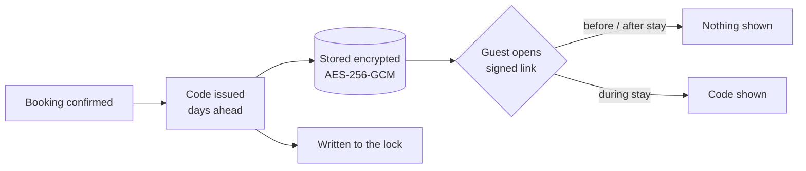

# Serviced-apartment access & pricing platform

**Door codes that only exist during the stay. Five apartments run end to end for a paying client.**

- Encrypted door codes, shown only during the stay
- Cleaner alerts and late checkout with no phone calls
- Pricing driven by local event demand

> Source is private (client system). **[Full write-up →](https://sajjad.omni-genai.com/projects/serviced-apartments)**

`Node.js` · `Express` · `SQLite` · `AES-256-GCM` · `HMAC` · `scrypt` · `Railway` · `Resend`

<b>How a door code works</b>

<b>Security</b>

- **Encrypted codes:** every door code is encrypted before it reaches the database, so a stolen copy holds nothing usable.
- **Signed links:** guest links are HMAC-signed with an expiry, so they can't be guessed or edited to point at another booking.
- **Passwords and webhooks:** staff passwords are scrypt-hashed, and webhooks are rejected unless the signature matches.
- **Kill switch:** rotating the signing secret cancels every outstanding link at once.

<b>Built around operations</b>

- **Codes go to the lock days ahead,** so a broadband fault on arrival day can't lock a guest out at night.
- **New code before old,** so a failed rotation never leaves a cleaner locked out.
- **Staff codes rotate weekly,** so a leaked code stops working on its own.
- **Built before the locks arrived:** a mock lock runs every path for real, and one setting swaps in the live provider.

<b>For guests and cleaners</b>

- Personal stay page: wifi, directions, check-in steps, house manual and local events during the stay.
- Codes appear at 15:00 on arrival and vanish at 10:00 on departure, correct across the clock change.
- Late checkout from the guest's own page moves the checkout time and the door code automatically.
- Checkout alerts the cleaner and puts the flat back on sale.

<b>Pricing from local demand</b>

- Three event sources merged daily: a venue listings page, a ticketing API and a fixtures feed.
- The scraper is polite: one run a day, conditional requests, and it stops on a refusal instead of retrying.
- Demand weightings are documented as estimates, to be replaced by the client's own occupancy data.

---

Built by **[Sajjad Mahessar](https://sajjad.omni-genai.com)** · [LinkedIn](https://www.linkedin.com/in/sajjadmahessar/)
